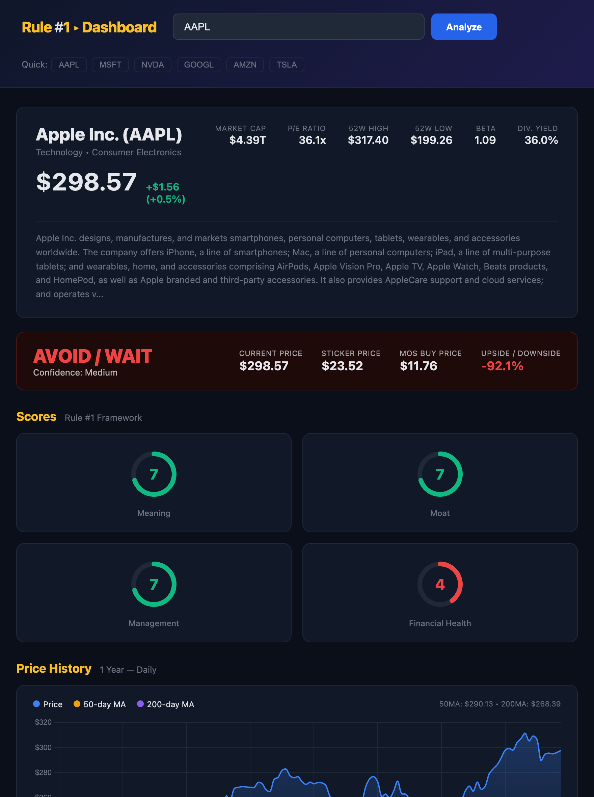

# Rule #1 Investing Dashboard

A single-file Python web app that runs a full **Phil Town "Rule #1"** stock analysis on any ticker using live data from Yahoo Finance. Type a symbol, and it pulls the financials, scores the business, runs three valuation models, checks the technical timing, and gives you a final verdict — all in your browser.



> **Disclaimer:** This is an educational tool, not financial advice. Do your own research before making any investment decision.

## What it shows

- **The Big 5 numbers** — ROIC plus the growth rates of Revenue, EPS, Book Value per share (Equity), and Free Cash Flow over the available history. Rule #1 wants each at 10%+ a year.
- **Moat & financial health scores** — the Big 5 against the 10% target (moat), and ROIC, debt-to-equity, current ratio, profit margin, and interest coverage (financial health), each distilled into a 1–10 score. Metrics Yahoo doesn't report are left out of the score rather than counted as failures. *Meaning* and *Management* are qualitative and are deliberately left for you to judge.
- **Three valuation models:**
  - **Ten Cap** — owner earnings × 10, where owner earnings = net income + depreciation & amortization + change in receivables + change in payables + income tax − capex (all capex is treated as maintenance capex, the conservative choice).
  - **Sticker Price** — EPS grown for 10 years, multiplied by a future P/E, discounted back at 15% a year, with a 50% Margin of Safety price. The growth rate is the lower of the company's historical growth (book value per share, or EPS if equity isn't growing) and analysts' long-term estimate, capped at 15%. The future P/E is the lower of 2 × growth and the stock's own historical P/E.
  - **Payback Time** — how many years of free cash flow, growing at that same rate, it takes to add up to the market cap (target: 8 years or less).
- **Technical timing** — 50/200-day moving averages plotted on a 1-year price chart, golden/death cross, 52-week range, and volume trend.
- **A final verdict** — Strong Buy / Buy / Watchlist / Avoid, with the reasons behind it. If earnings are negative or nothing shows positive growth, there is no Sticker Price and the dashboard says so instead of assuming a growth rate.

Foreign companies and ADRs are handled: statements reported in another currency are converted to the currency the stock trades in, and per-share figures are restated per quoted share.

## Run it locally

Requires **Python 3.8+**.

```bash
git clone https://github.com/isaacperezm26/rule1-dashboard.git
cd rule1-dashboard
pip install -r requirements.txt
python rule1_dashboard.py
```

The server starts on **http://localhost:8080** and opens your browser automatically. Enter any ticker (e.g. `AAPL`, `GOOGL`, `AMZN`) in the search bar. Use Yahoo Finance symbols for other markets and share classes (`BRK-B`, `SHOP.TO`, `VOD.L`).

Locally the server only listens on your own machine (`127.0.0.1`). Set `HOST=0.0.0.0` if you want other devices on your network to reach it, and `PORT` to change the port.

Press `Ctrl+C` to stop.

### Tests

The analysis engine has an offline test suite that replaces Yahoo Finance with fixtures:

```bash
python -m unittest discover -s tests -v
```

## How it works

The whole app is one file, `rule1_dashboard.py`, built on Python's standard-library HTTP server — no web framework. It:

1. Serves a single-page dashboard at `/`.
2. Fetches financials on demand from Yahoo Finance (via [`yfinance`](https://github.com/ranaroussi/yfinance)) at `/api/analyze?ticker=…`.
3. Computes the Rule #1 metrics and returns them as JSON, which the page renders.

On first run it will auto-install any missing dependencies.

## Deploying

A `Procfile` is included (`web: python rule1_dashboard.py`) for Heroku/Railway-style platforms, and the app reads the `PORT` environment variable when present.

> **Note:** Yahoo Finance frequently rate-limits or blocks requests coming from cloud/data-center IPs, so a hosted instance may fail to fetch data even when it works perfectly on your machine. Running locally is the most reliable option.

## License

[MIT](LICENSE) © Isaac Perez
